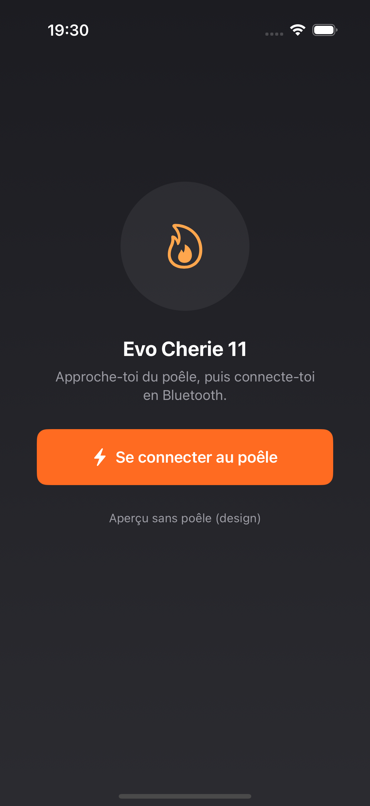
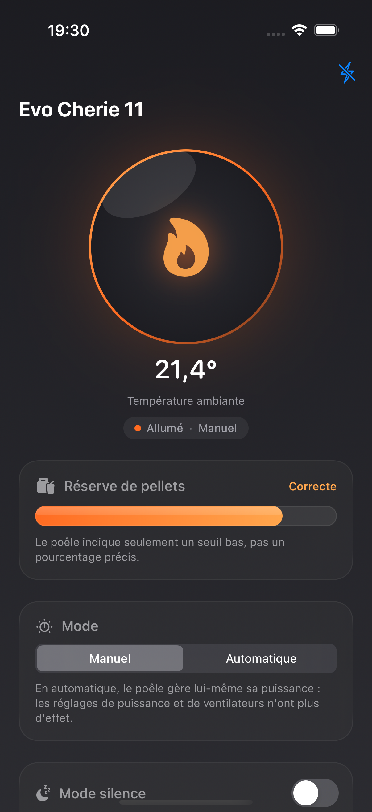
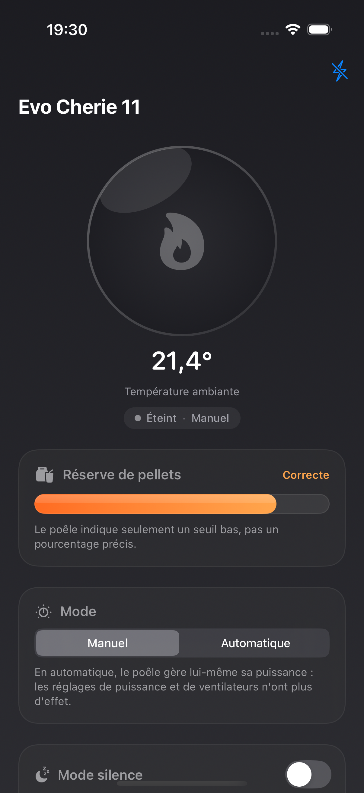
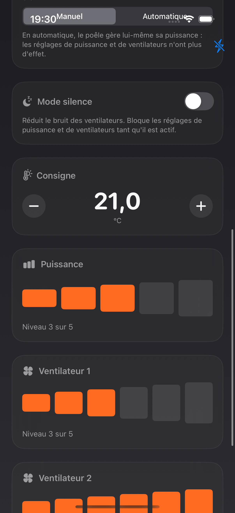

<p align="center">
  
</p>

<h1 align="center">EvoControl</h1>

<p align="center">
  A native iOS app to control an Edilkamin pellet stove directly over <strong>Bluetooth Low Energy</strong> — no Wi-Fi, no cloud account, no official "The Mind" app required.
</p>

<p align="center">
  
  
  
  
</p>

## Why this exists

Edilkamin's official app, **The Mind**, is built around a cloud account: the stove
connects to Wi-Fi, registers with Edilkamin's servers, and the app talks to that cloud
API. If your stove was never connected to Wi-Fi — mine wasn't, and isn't going to be —
you're stuck with whatever Bluetooth mode the app offers, which in my experience is
unreliable.

EvoControl skips the cloud entirely. It talks straight to the stove's own Bluetooth
radio, the same one the official app uses when it's not relying on Wi-Fi, using the
stove's native command protocol.

## Compatible stoves

Built and tested against an **Edilkamin Evo Cherie 11**. The Bluetooth protocol itself
isn't specific to that model — it's the same one Edilkamin uses across the "The Mind"
product line (confirmed by the open-source prior art this app builds on, see below) —
so it likely works, or is close to working, on other Edilkamin stoves controlled via
Bluetooth through "The Mind". It hasn't been verified on anything other than the Evo
Cherie 11, though. If you try it on a different model, I'd genuinely like to know
whether it worked — please open an issue either way.

Your stove needs to actually support local Bluetooth control (it advertises itself as
`EDILKAMIN_EP`) — this isn't related to whether it's also bound to Wi-Fi/cloud.

## Features

- Turn the stove on/off
- Read ambient temperature, target temperature, power level, fan 1/2/3 speed (when
  present), operating state
- Set the target temperature (5–35 °C, 0.5 °C steps)
- Set the manual power level and fan speeds (requires manual mode)
- Switch between automatic and manual power management
- "Relax" (quiet/night) mode
- Pellet reserve indicator
- Alarm code display and acknowledgment (with the same preconditions the stove itself
  enforces: it has to actually be in an alarm state, and powered off)
- A Bluetooth exchange log for troubleshooting, right in the app

Fan 2/3 controls only appear if your stove actually reports having them — detected
automatically, not assumed.

## How it works

The app encrypts short Modbus-RTU commands (read/write a register) with AES-128/CBC
and writes them to the stove over BLE; the stove answers over a notify characteristic,
encrypted the same way.

None of that protocol — the service/characteristic UUIDs, the AES key, the frame
layout, or the register map — was invented here. It's documented publicly, for the
same interoperability purpose (controlling your own stove without the vendor's app or
Wi-Fi), by [**netmb/Edilkamin_BT**](https://github.com/netmb/Edilkamin_BT), who
extracted it from the official app and validated it against real hardware. EvoControl
is an independent Swift/CoreBluetooth implementation built from that public
documentation — not a port of their C++/Arduino code.

The cloud side of things (for context, not used by this app) is covered by
[AndreMiras/python-edilkamin](https://github.com/AndreMiras/python-edilkamin).

See the comments in [`Sources/BLE/EdilkaminFrame.swift`](Sources/BLE/EdilkaminFrame.swift)
and [`Sources/BLE/EdilkaminRegisters.swift`](Sources/BLE/EdilkaminRegisters.swift) for
the details, including which parts are confirmed against a real stove and which are
best-effort (clearly marked as such).

## Known limitations

- The stove appears to accept only one Bluetooth connection at a time — you can't use
  EvoControl and the official app (or a Home Assistant/Homebridge bridge) at the same
  moment.
- A few write commands (switching *into* automatic mode, in particular) are the best
  reading of the public documentation rather than something personally confirmed on
  hardware. The app's diagnostic log makes it easy to check what actually happened.
- No scheduling ("Chrono"), no eco/comfort temperature presets, no pellet auger
  priming, no multi-user/family features — the app only covers what's listed above.

## Getting started

Requires [XcodeGen](https://github.com/yonaskolb/XcodeGen) and Xcode 16+.

```sh
xcodegen generate
open EvoControl.xcodeproj
```

Pick your own signing team in Xcode to install on a physical iPhone — Bluetooth
doesn't work in the Simulator, so that's required for anything beyond looking at the
UI. On first launch, grant the Bluetooth permission, stay near the stove, and tap
"Se connecter au poêle".

## Disclaimer

Not affiliated with, endorsed by, or supported by Edilkamin. Built from publicly
documented, independently reverse-engineered protocol details for personal
interoperability with hardware the author owns. Provided as-is — see [LICENSE](LICENSE).
Double-check any command against your stove's own display before trusting it,
especially anything marked as unverified in the code comments.

## License

[MIT](LICENSE)
